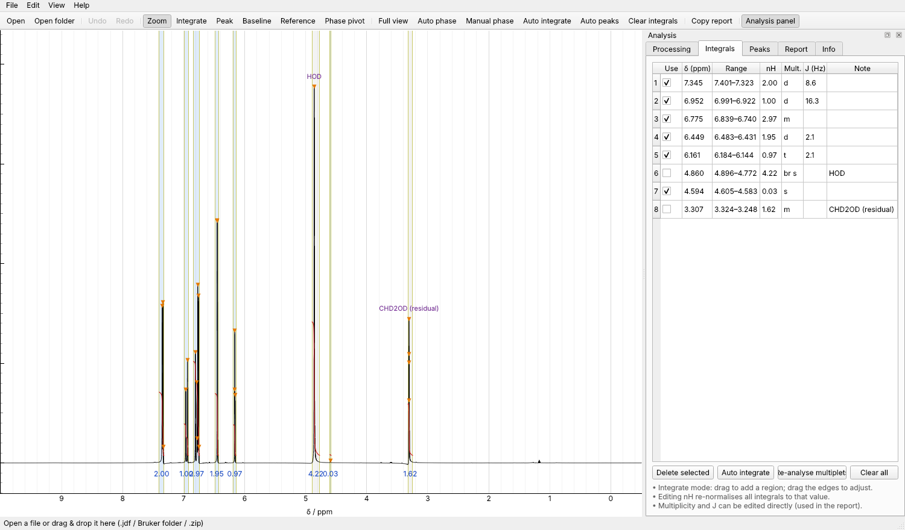
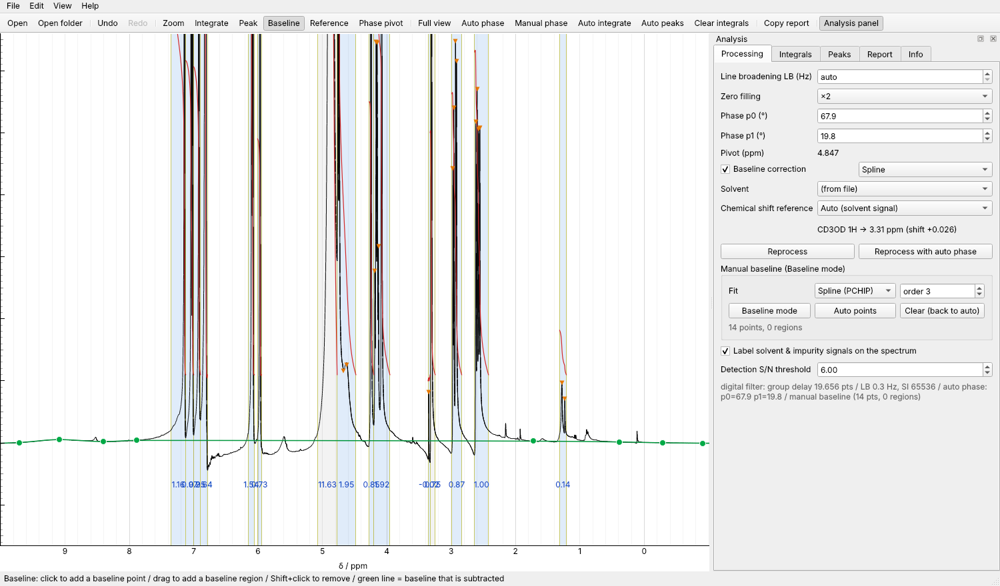
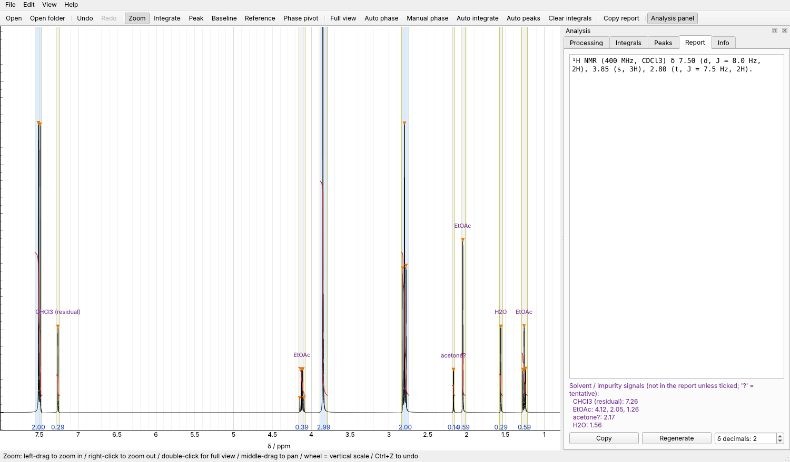
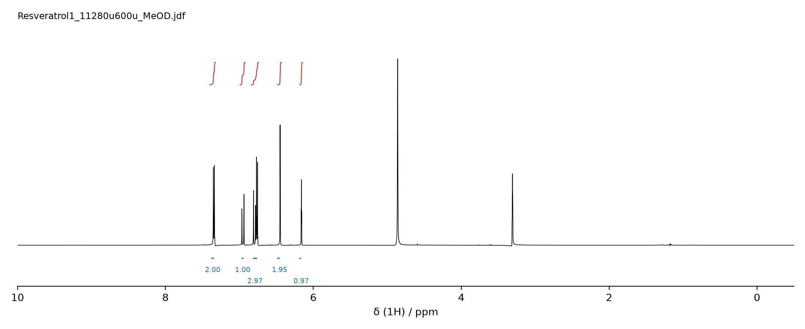

# jebru

**1D NMR processing for JEOL & Bruker on Linux — GUI and command line.**

*jebru* = **JE**OL + **BRU**ker: one open-source tool for raw data from both vendors.

It opens raw FIDs from JEOL (`.jdf`) and Bruker (experiment folder, `fid`, or a `.zip` of either), processes them automatically (digital-filter correction, apodization, FT, phasing, baseline correction, solvent referencing), and turns ¹H spectra into journal-style data:

```
¹H NMR (600 MHz, CD3OD) δ 7.35 (d, J = 8.6 Hz, 2H), 6.95 (d, J = 16.3 Hz, 1H),
6.81–6.75 (m, 3H), 6.45 (d, J = 2.1 Hz, 2H), 6.16 (t, J = 2.1 Hz, 1H).
```

It is aimed at small-molecule organic chemistry (¹H / ¹³C); ¹⁹F, ³¹P and other nuclei load and process as well.



---

## Features

- **Both vendors, one tool**: JEOL Delta `.jdf` and Bruker TopSpin raw data, including zipped datasets and already-processed JEOL spectra.
- **Automatic processing** that gives flat baselines and correct phases out of the box:
  - digital-filter group delay from JEOL `orders`/`factors` or Bruker `GRPDLY` / DSP tables;
  - exponential apodization, zero filling, FT;
  - automatic phasing (regional phase fit + ACME refinement);
  - spline or polynomial baseline correction;
  - referencing to the residual solvent signal.
- **Integration**: automatic integral regions that are normalised to whole proton counts, with interactive editing.
- **Multiplet analysis**: first-order J-tree analysis (s, d, t, q, dd, dt, td, ddd …) with J values.
- **Journal-format report**: ¹H and ¹³C data strings, one click to copy.
- **Solvent & impurity identification**: residual solvent, water, TMS and 44 common lab impurities (EtOAc, hexane, Et₂O, CH₂Cl₂, acetone, THF, toluene, DMF, grease …) in 12 deuterated solvents, based on Fulmer *et al.* 2010.
- **Manual tools**: manual phasing with live preview, baseline points/regions, reference peak, peak picking, integral editing.
- **Undo / redo** for everything, including zoom (`Ctrl+Z` / `Ctrl+Shift+Z`).
- **Export**: publication figure (PNG/PDF/SVG), CSV of peaks, integrals and spectrum, report text.
- **CLI batch mode** for processing whole folders.

| Baseline mode | Solvent / impurity labels |
|---|---|
|  |  |

---

## Installation

Requires Python ≥ 3.9 on Linux. The dependencies (numpy, scipy, nmrglue, matplotlib, pyqtgraph, PySide6) are installed automatically.

```bash
# Debian / Ubuntu: Qt runtime library needed by PySide6
sudo apt install libxcb-cursor0

git clone https://github.com/<your-account>/jebru.git
cd jebru
python3 -m venv ~/.venvs/jebru
~/.venvs/jebru/bin/pip install .
```

Optionally add jebru to your desktop application menu:

```bash
./install_desktop.sh
```

## Quick start

```bash
~/.venvs/jebru/bin/jebru                    # start the GUI
~/.venvs/jebru/bin/jebru sample.jdf         # open a file directly
~/.venvs/jebru/bin/jebru-cli sample.jdf     # print the report in the terminal
```

Drag & drop a `.jdf` file, a Bruker experiment folder or a `.zip` onto the window. Processing, integration, multiplet analysis and the report are done immediately; check the **Integrals** and **Report** tabs and correct anything that needs it.

---

## Using the GUI

### Modes (toolbar)

| Mode | Mouse |
|---|---|
| **Zoom** | left-drag: zoom in · right-click: zoom out · double-click: full view · middle-drag: pan · wheel: vertical scale · Ctrl+wheel: horizontal zoom |
| **Integrate** | drag to add a region (replaces overlapping ones); drag a region's edges to adjust |
| **Peak** | click to add · Shift+click to remove · drag the red dashed line to change the threshold |
| **Baseline** | click to add a baseline point · drag to add a baseline region · Shift+click to remove. Shows the raw spectrum and the green baseline that will be subtracted |
| **Reference** | click a peak and type its chemical shift (e.g. TMS = 0) |
| **Phase pivot** | click to set the pivot for first-order phasing |

### Analysis panel

`F9` shows or hides the panel. You can dock it left, right or at the bottom, float it, or resize it. Use *View ▸ Dock panel on the right* to reset the layout.

- **Processing**: LB, zero filling, phase, baseline method, solvent, reference mode, manual-baseline fit (PCHIP spline or polynomial), detection threshold, solvent/impurity labels on/off.
- **Integrals**: one row per region.
  - Edit **nH** to re-normalise all integrals to that value.
  - Edit **Mult.** or **J** to change what goes into the report.
  - Untick **Use** to leave a region out of the report.
- **Peaks**: peak list with impurity notes.
- **Report**: journal-format text plus a summary of the solvent and impurity signals that were found.
- **Info**: acquisition parameters from the file.

### Keyboard shortcuts

| Key | Action |
|---|---|
| `Ctrl+O` | open file |
| `A` | auto phase |
| `P` | manual phase (sliders, live preview) |
| `I` | auto integrate |
| `K` | auto peak picking |
| `F` | full view |
| `F9` | show / hide analysis panel |
| `Ctrl+Z` | undo (zoom, integrals, peaks, baseline points, phase, referencing, settings) |
| `Ctrl+Shift+Z` / `Ctrl+Y` | redo |
| `Ctrl+Shift+C` | copy report |
| `F1` | help |

---

## Command line

```bash
jebru-cli data/*.jdf --outdir results/           # figure, CSVs and report for every file
jebru-cli expno10/ --solvent DMSO-d6 --lb 0.5 --png fig.pdf
jebru-cli sample.jdf --p0 -12 --p1 30 --no-ref   # fixed phase, no referencing
```

| Option | Meaning |
|---|---|
| `--lb HZ` | exponential line broadening (default 0.3 Hz ¹H, 1 Hz ¹³C) |
| `--zf N` | zero-filling factor (default 2) |
| `--p0`, `--p1` | fixed phase in degrees (disables auto phasing) |
| `--solvent NAME` | override the solvent from the file |
| `--no-ref`, `--no-baseline` | skip solvent referencing / baseline correction |
| `--snr X` | peak-detection S/N threshold (default 6) |
| `--png FILE` | save a figure (`.png`, `.pdf`, `.svg`) |
| `--csv FILE`, `--spectrum-csv FILE` | peak list / spectrum as CSV |
| `--outdir DIR` | batch output: figure, peaks, integrals, spectrum and report per file |



---

## How it works

| Step | Details |
|---|---|
| Reading | JEOL via nmrglue's JDF reader; Bruker `acqus` + `fid`. |
| Digital filter | Group delay from JEOL `orders`/`factors` or Bruker `GRPDLY` / DSP tables. The integer part is applied as a circular shift, so the acausal filter response wraps to negative time; the fractional part is applied as a linear phase after FT. JEOL spectra are cropped to `x_sweep_clipped`, the filter pass band. |
| Phase | The zero-order phase of each isolated signal region is fitted linearly against position to give p0/p1. The result is then refined with ACME entropy minimisation, using several starting points when S/N is high. |
| Baseline | Noise points are found from the local standard deviation (Golotvin–Williams style), binned, and fitted with a smoothing spline. Manual mode uses PCHIP or a polynomial through user-chosen points and regions. |
| Referencing | The residual solvent line nearest the literature value is used; for solvent multiplets, the centre line of the multiplet. |
| Integration | Smoothed-signal threshold, region splitting at clear gaps, solvent cut-out, and normalisation to near-integer proton counts. |
| Multiplets | Recursive J-tree decomposition of the line list with position and intensity tolerances (allowing for roofing). |
| Impurities | A multi-signal compound is **confirmed** only if every signal is found with the right multiplicity and integral ratio. Confirmed signals are labelled and left out of the report. A single-signal match is labelled with `?` and excluded only if it is small (< 0.5 H). |

### Supported solvents

Referencing and the impurity tables cover THF-d₈, CD₂Cl₂, CDCl₃, toluene-d₈, C₆D₆, C₆D₅Cl, acetone-d₆, DMSO-d₆, CD₃CN, TFE-d₃, CD₃OD and D₂O. Referencing also covers pyridine-d₅.

---

## Limitations

- **1D only.** 2D data (COSY / HSQC / HMBC) are not supported yet.
- Multiplet analysis is first order. Strongly coupled systems (AA'BB' …) and overlapping multiplets are reported as `m`; edit them in the table.
- Automatic integral regions and normalisation are a starting point. Always check the proton counts.
- Impurity matching uses literature averages (±0.025 ppm ¹H, ±0.3 ppm ¹³C). Signals hidden under compound multiplets are not detected.

---

## Development

```bash
pip install -e . pytest
pytest tests
```

The tests use synthetic FIDs with known shifts, couplings and integrals, a simulated digital-filter delay and residual-solvent and impurity signals. They also spot-check the impurity tables against the published values. Real-data validation used the [cheminfo](https://github.com/cheminfo) `jeol-data-test` and `bruker-data-test` sets: JEOL ECZ 400/600 ¹H/¹³C/¹⁹F, and Bruker 300–600 MHz with DSPFVS 10 and 20.

Project layout:

```
jebru/
  io.py          JEOL / Bruker readers, digital-filter parameters
  processing.py  FT, phasing, baseline, referencing
  analysis.py    peaks, integrals, multiplets, report
  impurities.py  solvent / impurity tables (Fulmer 2010)
  plotting.py    publication figure (matplotlib)
  gui.py         PySide6 + pyqtgraph GUI
  cli.py         command line / batch
tests/           pytest suite
docs/            screenshots
```

---

## References

- G. R. Fulmer, A. J. M. Miller, N. H. Sherden, H. E. Gottlieb, A. Nudelman, B. M. Stoltz, J. E. Bercaw, K. I. Goldberg, *Organometallics* **2010**, *29*, 2176–2179. Source of the solvent and impurity tables.
- H. E. Gottlieb, V. Kotlyar, A. Nudelman, *J. Org. Chem.* **1997**, *62*, 7512–7515. Source of the MTBE, 2-butanone and DMSO values.
- L. Chen, Z. Weng, L. Goh, M. Garland, *J. Magn. Reson.* **2002**, *158*, 164–168. ACME automatic phasing.
- J. J. Helmus, C. P. Jaroniec, *J. Biomol. NMR* **2013**, *55*, 355–367. nmrglue.

## License

MIT
